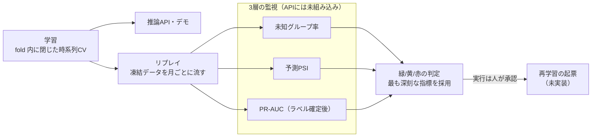
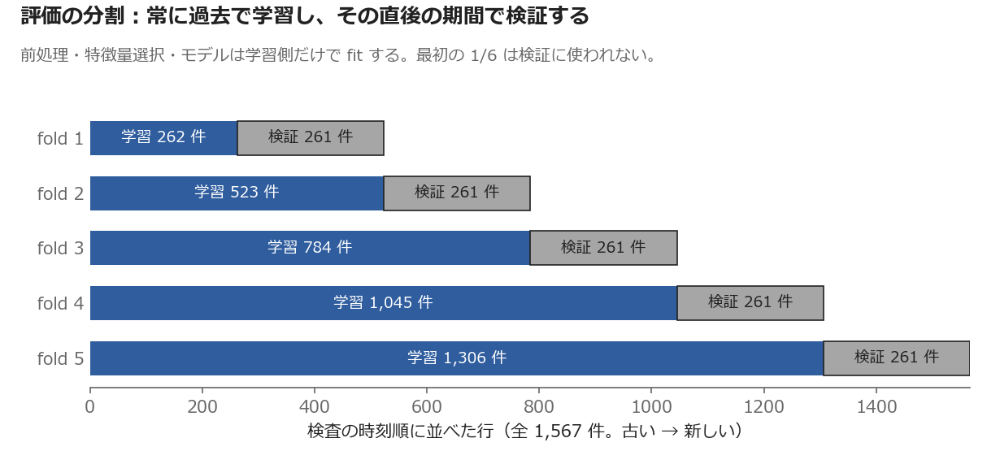
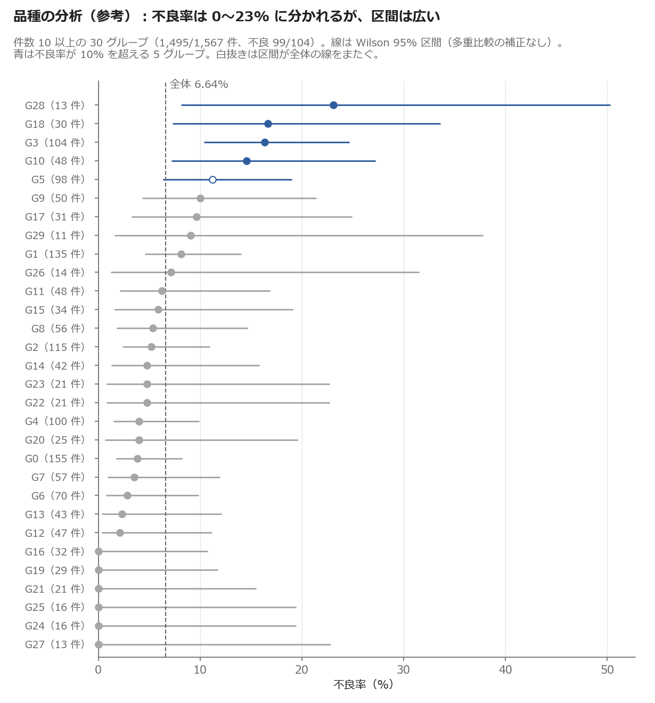
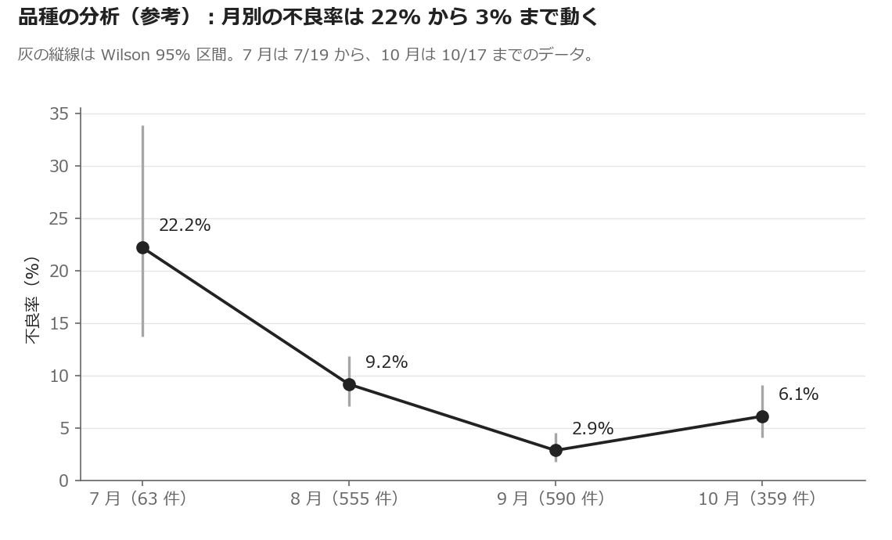
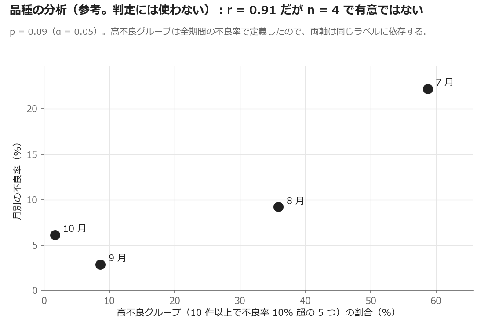
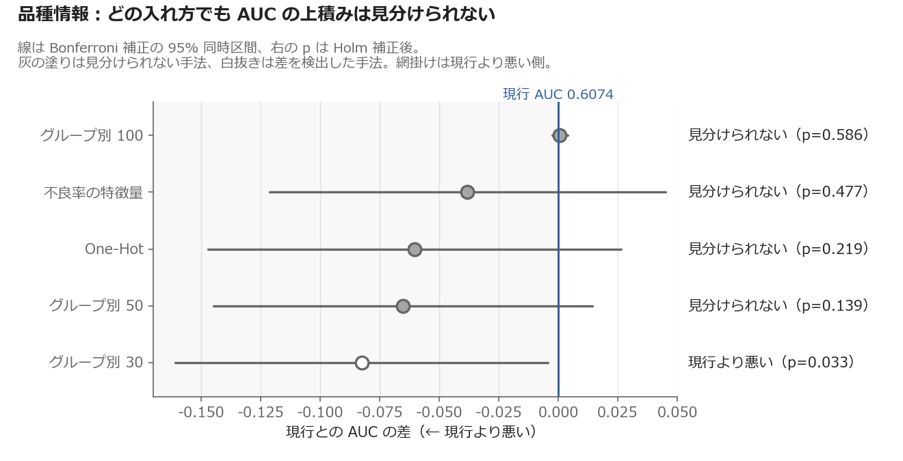
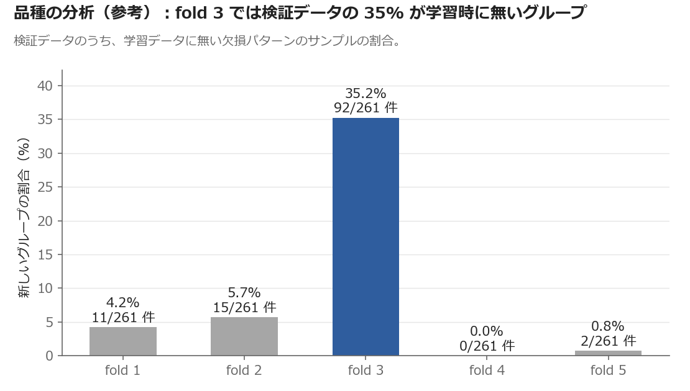
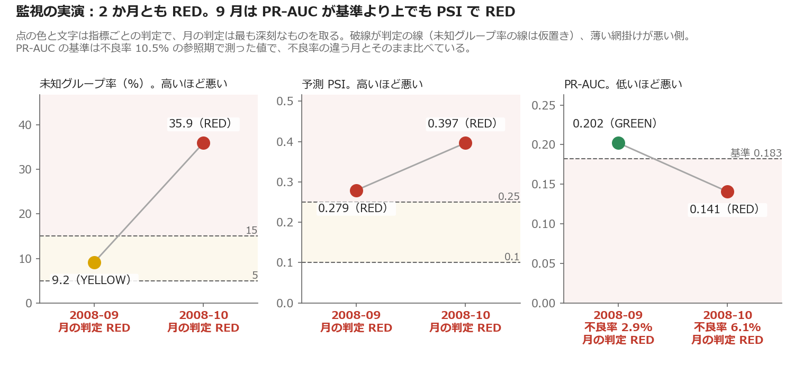

# SECOM 不良予測 ― リークを除くとAUCは0.61。その実力で使える範囲を決め、API化と監視の実演まで行った

半導体製造ラインのセンサーデータ（[UCI SECOM](https://archive.ics.uci.edu/dataset/179/secom)）で、精度に限界のあるモデルを誰でも同じ結果で再現でき、使える範囲が分かる状態にするには何が要るかを問う。全工程を fold 内に閉じた評価、検定によるしきい値・モデルの見直し、推論API（FastAPI + Docker）、ドリフト監視の実演までを行った。

[デモ（Hugging Face Spaces）](https://huggingface.co/spaces/yuya-h/secom-defect-demo) ／ 記事: [考察編](https://zenn.dev/yuya0408/articles/secom-defect-analysis)・[実装編](https://zenn.dev/yuya0408/articles/secom-defect-serving)・[運用編](https://zenn.dev/yuya0408/articles/secom-defect-operations)

> 示すのは、凍結データ上の評価、動く推論API、監視の計算と判定の実演である。実ラインでの効果、常時稼働の監視、再学習の実行は示さない（[限界と範囲外](#限界と範囲外)）。



---

## 結果サマリー

| 項目 | 値 |
|---|---|
| データ | 1,567 件 × 590 センサー、不良 104 件（**6.64%**）、欠損 4.54% |
| 評価（時系列CV、out-of-fold 1,305 件、不良 65 件） | **AUC 0.6074**、PR-AUC 0.1346（評価対象の不良率 0.050 の約 2.7 倍） |
| リークの影響（同じ構成、上位 100 列） | AUC 0.7142 → 0.6108 |
| 既定しきい値 | **0.0612**（規則「不良確率の上位 50% を検査に回す」から計算。0.5 では 1 件も判定されない） |
| 上位 50% を検査したときの再現率 | **66.2%**（fold 別 60〜71%、ランダムなら 50%） |
| モデル 2 種・構成 5 種との比較 | **どれも現行と見分けられない**（Holm 補正後 p ≥ 0.136）。現行のまま |
| 品種情報を入れる 5 手法との比較 | 上積みは見分けられない。1 手法は現行より悪い |
| 監視のリプレイ（2008-09、2008-10） | 未知グループ率 9.2% → 35.9%。**2 か月とも RED** |

## 用語

| 用語 | 意味 |
|---|---|
| 時系列CV | 検査の時刻順に並べ、過去で学習して直後の期間で検証する 5 分割。前処理・特徴量選択・モデルはすべて学習側だけで fit する |
| out-of-fold | 学習に使っていない fold での予測。最初の 1/6 は学習専用で予測を持たない |
| 品種グループ | 欠損率 10〜70% の列の欠損パターンが同じサンプルの集まり。品種の代理と見る仮説で、確かめてはいない |
| 未知グループ率 | 参照期に無かった品種グループのサンプルの割合 |
| PSI | 予測確率の分布が基準からどれだけずれたかの指標（Population Stability Index） |
| r | 流出 1 件の損失 ÷ 検査 1 件の費用。業務上の仮定 |

---

## リークを除くとAUCは0.72→0.61に下がる

**全データで特徴量を選んでから評価すると、同じ構成でも AUC は 0.1 以上高く見える。**

| 特徴量選択 | リークあり（全データで選択） | リークなし（fold 内で選択） | 差 |
|---|---|---|---|
| 上位 50 列 | 0.7023 | 0.5739 | +0.1283 |
| 上位 100 列 | 0.7142 | 0.6108 | +0.1035 |

当初の分析で出た 0.7180 のコードはリポジトリに残っていないので、同じ手順を作り直して確かめた。現行のモデルは特徴量選択をしない構成で、AUC は 0.6074 である。根拠: [`reports/leak_check.md`](reports/leak_check.md)。



青で学習し、灰で検証する。行を下るほど学習データが増える。

## しきい値は確率の値ではなく順位で決める必要がある

**未知のデータの不良確率は最大 0.36 で、0.5 では 1 件も判定されない。確率は学習データが増えるほど低く出るので、値で決めたしきい値は再学習のたびにずれる。**

| 検査に回す割合 | 再現率 | ランダムの場合 | fold 別の再現率（%） |
|---|---|---|---|
| 30% | 38.5% | 30% | 36 / 17 / 60 / 23 / 50 |
| **50%（既定）** | **66.2%** | 50% | 64 / 67 / 60 / 69 / 71 |
| 70% | 84.6% | 70% | 82 / 83 / 80 / 92 / 86 |
| 90% | 92.3% | 90% | 91 / 100 / 90 / 92 / 93 |

既定しきい値 0.0612 は、最後の fold（最終モデルに最も近い）で上位 50% の境目にあたる値である。`src/train.py` が学習のたびに計算し、規則・前提・表とともに `models/metadata.pkl` に記録する（API の `/metadata` で読める）。50% という割合は、この表を見た後に業務上の仮定として選んだ。

```text
1 個あたりの費用 = 検査割合 + r × 不良率 × 見逃し率     （全数検査の費用は 1）
```

| r | 費用が最小の割合（1% 刻み） | 上位 50% の費用 | 全数検査との比較 |
|---|---|---|---|
| 15 | 7%（0.668） | 0.753 | 上位 50% の方が安い |
| **20** | 41%（0.824） | **0.837**（10% 刻みの候補では最小） | 上位 50% の方が安い |
| 25 | 69%（0.882） | 0.921 | 上位 50% の方が安い |
| 30 | 69%（0.920） | 1.006 | 上位 50% は全数検査より高い |
| 41 以上 | 100% | 1.0 超 | どの割合より全数検査が安い |

最適な割合は r で大きく動くので、50% は r = 20 の仮定に結びついた選択である。**r が約 41 以上の工程では全数検査が最も安く、このモデルは使う理由がない。** 根拠: [`src/train.py`](src/train.py) の `cost_breakeven`。

## モデルも構成も、入れ替えるほどの差は見分けられない

**結果を見る前に決めた規則（Holm 補正後 p < 0.05 で相手が良いときだけ入れ替える）を満たす相手は無く、現行のままにした。**

| 比較の相手 | AUC | 現行との差 | 95% 区間（補正前） | p（Holm） | 判定 |
|---|---|---|---|---|---|
| ロジスティック回帰 | 0.6141 | +0.007 | [−0.098, +0.112] | 0.900 | 見分けられない |
| HistGradientBoosting | 0.5717 | −0.036 | [−0.108, +0.036] | 0.663 | 見分けられない |
| A: 雑な前処理 | 0.5210 | −0.086 | [−0.163, −0.010] | 0.136 | 見分けられない |
| B: 雑な前処理 + 時系列特徴量 | 0.5757 | −0.032 | [−0.096, +0.033] | 1.000 | 見分けられない |
| D: 現行 + 時系列特徴量 | 0.5985 | −0.009 | [−0.075, +0.057] | 1.000 | 見分けられない |
| E-50: D + 特徴量選択 50 列 | 0.5739 | −0.034 | [−0.104, +0.037] | 1.000 | 見分けられない |
| E-100: D + 特徴量選択 100 列 | 0.6108 | +0.003 | [−0.064, +0.071] | 1.000 | 見分けられない |

区間の幅は ±0.07〜0.1 あり、AUC でそれ未満の差はこのデータ量では見分けられない。「同等」という意味ではない。A の区間は 0 を含まないが、これは補正前の値で、補正後は規則を満たさない。根拠: [`reports/model_comparison.md`](reports/model_comparison.md)・[`reports/config_comparison.md`](reports/config_comparison.md)。

## 欠損パターンで不良率は分かれるが、品種の違いとまでは言えない

**44 列の欠損パターンは 49 種類に収束し、グループの不良率は 0〜23% に分かれる。ただし区間は広く、月別の変動との関係も n = 4 で有意ではない。**



点が不良率、線が Wilson 95% 区間。破線より右に区間全体がある青の 4 グループだけが、全体より高いと読める（白抜きの G5 はまたぐ）。



灰の縦線が Wilson 95% 区間。7 月は 63 件（7/19 から）しかなく、区間が広い。



1 点が 1 か月。高不良グループは全期間の不良率で定義したので、両軸は同じラベルに依存する。根拠: [`notebooks/secom_strict_analysis.ipynb`](notebooks/secom_strict_analysis.ipynb) の Step 6。

## 品種情報を入れても、AUCの上積みは見分けられない

**5 手法のどれも現行を上回ると言えず、グループ別 30 は Holm 補正後も現行より悪い。**



0 の線より左（網掛け）が現行より悪い側。線は Bonferroni の同時区間で、0 をまたぐ手法は見分けられない。

学習時に無いグループの多さは、理由とは言えない。新しいグループが最も多い fold 3（35.2%）ではグループ別 50 が 0.725 と現行の 0.653 を上回り、大きく落ちるのは 0.8% しかない fold 5（0.364、現行 0.667）である。理由の候補はグループあたりのサンプルの少なさと、欠損フラグにグループの情報がすでに入っていることだが、切り分けていない。根拠: [`reports/group_info_comparison.md`](reports/group_info_comparison.md)。



青が最も割合の高い fold。学習時に無いグループには、グループの情報を使えない。

## 評価値としきい値をモデルと一緒に保存するので、組み合わせがずれない

**手で書いた評価値を持たず、`src/train.py` が学習のたびに計算して `models/metadata.pkl` に保存する。** 同じ環境で学習し直すと、`model.pkl` はハッシュまで一致した。

| 仕組み | 何を防ぐか | 場所 |
|---|---|---|
| 前処理クラスを独立モジュールに置く | ノートブックで定義すると pickle のパスが `__main__` になり、別プロセスの API から復元できない | [`src/preprocessing.py`](src/preprocessing.py) |
| 評価値・しきい値を学習時に計算して保存 | モデルと評価値・しきい値の組み合わせのずれ | [`src/train.py`](src/train.py) |
| 応答にモデルの版を入れる | どの予測がどのモデルから出たか分からなくなること | [`src/api.py`](src/api.py) |
| CI で `data/` から再学習してテスト | 同梱モデルに頼った動作確認 | [`.github/workflows/ci.yml`](.github/workflows/ci.yml) |
| デモは API と同じコードとモデルを使う | デモと API の結果のずれ（同期は手動） | [`app.py`](app.py) |

## 未知グループ率は9%→36%に増え、監視は2か月ともREDを出す

**時系列で新しいグループが出ることは監視の指標でも見える。ただし 9 月は PR-AUC が基準より上でも PSI で RED になり、誤報かどうかはこのデータでは判断できない。**



点の色と文字が指標ごとの判定で、目盛りの色と文字が月の判定（最も深刻なものを取る）。

| 月 | 未知グループ率 | 予測 PSI | PR-AUC | 判定 |
|---|---|---|---|---|
| 2008-09 | 9.2%（黄） | 0.279（赤） | 0.202（基準以上） | RED |
| 2008-10 | **35.9%**（赤） | 0.397（赤） | 0.141（基準未満で赤。限界の表を参照） | RED |

| 判定 | 定義した動き（`RECOMMENDED_ACTIONS`。文字列の定義のみで、実行するコードは無い） |
|---|---|
| 緑 | 通常運用。指標を記録するのみ |
| 黄 | 推論は継続しつつ通知・ダッシュボード警告。レスポンスに `drift_warning` を付与 |
| 赤 | 推論は返すが信頼度を下げ、該当ロットを全数検査へ。再学習を起票（自動実行しない） |

根拠: [`reports/drift_report.md`](reports/drift_report.md)・[`src/monitoring.py`](src/monitoring.py)。

---

## 方法

**共通の条件**

| 項目 | 値 |
|---|---|
| 評価 | `TimeSeriesSplit` 5 分割（検査の時刻順）、fold 平均の AUC・PR-AUC |
| モデル（現行） | `RandomForestClassifier(n_estimators=200, max_depth=10, class_weight="balanced", random_state=42)` |
| ハイパーパラメータ | 固定。内側ループの探索はしていない |
| 前処理（現行） | 定数列・準定数列（95%）・高欠損列（50%）を削除、欠損率 5〜50% の列に欠損フラグ、中央値補完。590 → 460 列（436 列 + フラグ 24 列） |

RF は比較で選んだモデルではなく、高次元・少サンプルの表形式でチューニングをほとんどせずに崩れにくい出発点として置いた。比較は 2026-10 に初めて行った。

**判定**

| 比較 | 検定 | 規則 | なぜその規則か | いつ決めたか |
|---|---|---|---|---|
| モデル 2 種 | fold 別 DeLong、2 比較に Holm | p < 0.05 で相手が良いときだけ替える | 替えると API・監視の基準・文書をやり直す費用がかかる | 結果を見る前 |
| 構成 5 種 | fold 別 DeLong、5 比較に Holm | p < 0.05 でなければ「見分けられない」 | 平均 AUC の並びだけで最良と言わない | 結果を見る前 |
| 品種情報 5 手法 | fold 別 DeLong、5 比較に Holm | 同上 | 同上 | 平均 AUC を見た後 |
| 既定しきい値 | 検定なし | 上位 50% | r = 20 の仮定で 10% 刻みの最小 | 再現率の表を見た後 |

**監視の判定の線**

| 指標 | 見るもの | ラベル | 黄 | 赤 | 線の由来 |
|---|---|---|---|---|---|
| 未知グループ率 | 欠損パターンが参照期に無かった割合 | 不要 | 5% | 15% | **仮置き**。根拠の記録は無く、実運用では誤報と見逃しの実績から決め直す前提 |
| 予測 PSI | 不良確率の分布のずれ | 不要 | 0.10 | 0.25 | PSI で慣用される目安 |
| PR-AUC | 検査結果に対する性能 | 必要 | — | 基準 0.1825 未満 | 参照期の不良で層別した 5 分割の out-of-fold |

リプレイは 2008-07〜08（618 件、不良 65 件）を参照期として学習し、09・10 月を順に流す。

検定とリプレイは記事の公開（2026-07）の後、2026-10 に足した。記事は当時の記録として書き換えておらず、しきい値とモデルの比較はこの README の方が新しい。

## 限界と範囲外

| 項目 | 何が言えないか | 結論への影響 | 根拠 |
|---|---|---|---|
| 不良が 65 件 | ±0.07〜0.1 未満の AUC の差を見分けられない | 比較の結論は「入れ替える理由が無い」までで、「同等」「現行が最良」ではない | [比較の表](#モデルも構成も入れ替えるほどの差は見分けられない) |
| 凍結データ | 再学習もラインへの適用もしていないので、実際の効果は分からない | 示せるのは評価と仕組みまで | — |
| 0.0612 の適用範囲 | 同じ値を fold 1 に当てると 98% が検査対象になる（fold 5 は 50%）。全データで学習した最終モデルの未知データでの割合は未検証 | 「上位 50%」が保たれるとは限らない。運用するなら直近の予測の分位点で置き直す前提 | `src/train.py` |
| 費用の仮定 | r は業務上の仮定で、再現率の曲線は不良 65 件の階段状 | 最適な割合は幅を持って読む | [費用の表](#しきい値は確率の値ではなく順位で決める必要がある) |
| 0.7180 の出どころ | 当初のコードが無く、作り直しの値（0.7142）と一致はしない | リークの方向と大きさの確認にとどまる | [`reports/leak_check.md`](reports/leak_check.md) |
| 監視の期間 | 2 か月だけで、誤報率も見逃し率も測れない | 判定の線の良し悪しは評価していない | [`reports/drift_report.md`](reports/drift_report.md) |
| PSI の基準 | 基準は参照期の 8 割で学習した予測で、リプレイは全参照期で学習したモデルの予測。ずれの一部はこの差かもしれない（切り分けていない） | 9 月の RED は割り引いて読む | `scripts/replay_drift.py` |
| PR-AUC の基準（分割） | 時間順ではなく層別の分割で作った（時間順だと fold の不良が 18/21/13/6/7 件に偏る）。時間順より楽観的になりうる | 基準割れの判定は出やすい側 | `scripts/replay_drift.py` |
| PR-AUC の基準（不良率） | PR-AUC は不良率に左右されるのに、基準は不良率 10.5% の参照期の値で、月の不良率（2.9%、6.1%）と違う。不良率に対する倍率は基準 1.7 倍、9 月 7.0 倍、10 月 2.3 倍で、10 月の基準割れは不良率の違いで説明できる可能性がある | 性能の低下とは言えない。判定の規則は変えず、そのまま示している | [`src/monitoring.py`](src/monitoring.py) |
| 監視と API | API は監視を呼ばない。`drift_warning` は未実装で、アラート・ダッシュボード・再学習パイプラインも無い | 監視は別スクリプトでの実演 | [`src/api.py`](src/api.py) |
| 品種の解釈 | センサーが匿名で、欠損パターンが品種を表すかは確かめられない。推測である | 仮説の材料にとどめる | [品種の節](#欠損パターンで不良率は分かれるが品種の違いとまでは言えない) |
| 時刻の意味 | タイムスタンプは検査時刻で、製造順と同じとは限らない | 時系列CVの順序は検査の順 | `data/secom.names` |
| 図 3 の循環 | 高不良グループを全期間の不良率で定義している | r = 0.91 は高めに出うる | `scripts/make_figures.py` |

## 詳しい値

**検査割合ごとの再現率**（`/metadata` の `threshold_rule.inspection_table`）

| 検査に回す割合 | 再現率 | 適合率 | ランダムとの差 | fold 別の再現率（%） |
|---|---|---|---|---|
| 10% | 23.1% | 11.1% | +13.1 | 27 / 0 / 40 / 8 / 29 |
| 20% | 32.3% | 7.9% | +12.3 | 32 / 0 / 60 / 8 / 50 |
| 30% | 38.5% | 6.3% | +8.5 | 36 / 17 / 60 / 23 / 50 |
| 40% | 53.8% | 6.7% | +13.8 | 55 / 67 / 60 / 31 / 64 |
| 50% | 66.2% | 6.6% | +16.2 | 64 / 67 / 60 / 69 / 71 |
| 60% | 73.8% | 6.1% | +13.8 | 64 / 83 / 60 / 92 / 79 |
| 70% | 84.6% | 6.0% | +14.6 | 82 / 83 / 80 / 92 / 86 |
| 80% | 87.7% | 5.5% | +7.7 | 86 / 100 / 80 / 92 / 86 |
| 90% | 92.3% | 5.1% | +2.3 | 91 / 100 / 90 / 92 / 93 |

**fold ごとの値**

| fold | 検証の件数 | 不良 | AUC | 確率の平均 | 確率の最大 | 新しいグループの割合 |
|---|---|---|---|---|---|---|
| 1 | 261 | 22 | 0.588 | 0.153 | 0.362 | 4.2% |
| 2 | 261 | 6 | 0.565 | 0.119 | 0.209 | 5.7% |
| 3 | 261 | 10 | 0.653 | 0.076 | 0.192 | 35.2% |
| 4 | 261 | 13 | 0.564 | 0.066 | 0.162 | 0.0% |
| 5 | 261 | 14 | 0.667 | 0.065 | 0.198 | 0.8% |

**品種情報の比較**

| 手法 | AUC | 現行との差 | 95% 区間（補正前） | p（Holm） | 判定 |
|---|---|---|---|---|---|
| One-Hot | 0.5470 | −0.060 | [−0.126, +0.006] | 0.219 | 見分けられない |
| 不良率の特徴量 | 0.5693 | −0.038 | [−0.102, +0.025] | 0.477 | 見分けられない |
| グループ別 100 | 0.6081 | +0.001 | [−0.002, +0.003] | 0.586 | 見分けられない |
| グループ別 50 | 0.5422 | −0.065 | [−0.126, −0.005] | 0.139 | 見分けられない |
| グループ別 30 | 0.5249 | −0.083 | [−0.142, −0.023] | 0.033 | 現行より悪い |

**品種の分析とリプレイ**

| 月 | 件数 | 不良率 | 高不良グループの割合 | リプレイの AUC |
|---|---|---|---|---|
| 2008-07 | 63 | 22.2% | 58.7% | 参照期 |
| 2008-08 | 555 | 9.2% | 35.9% | 参照期 |
| 2008-09 | 590 | 2.9% | 8.6% | 0.705 |
| 2008-10 | 359 | 6.1% | 1.7% | 0.658 |

## 実行環境

| 用途 | 環境 |
|---|---|
| 手元の学習・図・同梱モデル | Windows 11、Python 3.13.7、CPU のみ（GPU 不要） |
| CI・Docker | Python 3.12。CI は `data/` から学習し直してテストする。Docker（`python:3.12-slim`）は同梱モデルで起動と推論を確かめた |
| デモ | Hugging Face Spaces、Python 3.13、Gradio 6.19.0。無料枠でスリープするので、開くと起動を待つことがある |
| 依存 | scikit-learn 1.8.0 ほか、`requirements*.txt` で固定 |

## 動かし方

```bash
# 1. 依存（テストまで）
pip install -r requirements-dev.txt

# 2. モデルを data/ から学習し直す（評価値・既定しきい値もここで計算される）
python -m src.train

# 3. API 起動 → http://localhost:8000/docs
uvicorn src.api:app --reload

# 4. 別の端末で推論を試す
curl -X POST http://localhost:8000/predict \
  -H "Content-Type: application/json" \
  -d @sample_input.json
# => {"defect_probability":0.6597...,"is_defect":true,"threshold":0.0612,"model_version":"1.1.0"}

# 5. テスト
pytest -q
```

`sample_input.json` は実データの不良の行で、**学習データに含まれる**。そのため確率は 0.66 と高く出る。

Docker（イメージには `src/` と `models/` だけを含める）:

```bash
docker compose up --build
curl http://localhost:8000/health
# => {"status":"ok","model_loaded":true}
```

比較・図・デモの再生成:

```bash
python -m scripts.compare_models      # → reports/model_comparison.md
python -m scripts.compare_configs     # → reports/config_comparison.md
python -m scripts.compare_group_info  # → reports/group_info_comparison.md
python -m scripts.reproduce_leak      # → reports/leak_check.md

pip install -r requirements-extras.txt   # 図とデモに要る。図には日本語フォントも要る
python -m scripts.replay_drift           # → reports/drift_report.md、fig7
python -m scripts.make_figures           # → fig1〜fig6
python app.py                            # デモ → http://localhost:7860
```

> `models/*.pkl` はすぐ試せるよう同梱しているが、pickle は読み込み時に任意のコードを実行しうる。信頼できる出所からのみ読み込み、不安なら `python -m src.train` で作り直す。

| メソッド | パス | 説明 |
|---|---|---|
| GET | `/` | サービス概要 |
| GET | `/health` | ヘルスチェック |
| GET | `/metadata` | モデル・評価値・しきい値の規則 |
| POST | `/predict` | 1 件の推論（`features`: 590 個、欠損は `null` 可。`threshold` は任意、省略時は既定値） |
| POST | `/predict/batch` | 複数件の推論 |

## ディレクトリ構成

```text
secom-defect-prediction/
├── requirements.txt          # API・学習の依存（Docker はこれだけ）
├── requirements-dev.txt      # + テスト（CI が入れる）
├── requirements-extras.txt   # + 図・Gradio デモ
├── Dockerfile / docker-compose.yml
├── sample_input.json         # API の動作確認用（実データの不良行 1 件）
├── app.py                    # Gradio デモ（Hugging Face Spaces へは手で同期）
├── MODEL_CARD.md             # モデルの用途・評価・限界
├── src/
│   ├── preprocessing.py      # 前処理クラス
│   ├── train.py              # 時系列CV、しきい値の決定、最終モデルの学習と保存
│   ├── monitoring.py         # PSI・未知グループ率・深刻度の判定
│   └── api.py                # FastAPI の推論サーバー
├── models/                   # 学習済みの preprocessor / model / metadata
├── data/                     # UCI のオリジナルファイル
├── notebooks/
│   └── secom_strict_analysis.ipynb  # 考察編の分析（Step 2〜5: 評価、Step 6: 品種、Step 7: 組み込み）
├── reports/
│   ├── leak_check.md             # リークの影響
│   ├── model_comparison.md       # モデルの比較
│   ├── config_comparison.md      # 前処理・特徴量の構成の比較
│   ├── group_info_comparison.md  # 品種情報を入れる方法の比較
│   ├── drift_report.md           # 監視のリプレイ結果
│   └── figures/                  # 図（fig1〜fig7）
├── scripts/
│   ├── auc_tests.py              # fold 別 DeLong + Holm
│   ├── reproduce_leak.py         # → leak_check.md
│   ├── compare_models.py         # → model_comparison.md
│   ├── compare_configs.py        # → config_comparison.md
│   ├── compare_group_info.py     # → group_info_comparison.md
│   ├── replay_drift.py           # → drift_report.md、fig7
│   ├── make_figures.py           # → fig1〜fig6
│   ├── figure_style.py           # 図の共通設定
│   └── make_sample_input.py      # → sample_input.json
├── tests/                    # API・監視のテスト（pytest）
└── .github/workflows/ci.yml  # 学習 → テスト
```

## データ・ライセンス・出典

- データ: McCann, M. & Johnston, A. (2008). *SECOM* [Dataset]. UCI Machine Learning Repository. <https://archive.ics.uci.edu/dataset/179/secom>（`data/` にオリジナルファイルをそのまま収録）
- コード・モデル: [MIT License](LICENSE)
- モデルの用途と限界: [`MODEL_CARD.md`](MODEL_CARD.md)
- DeLong 検定: DeLong, E. R., DeLong, D. M. & Clarke-Pearson, D. L. (1988). *Biometrics*, 44(3), 837–845.

<!-- gbrain: [Source: User, READMEの整備(運用の基盤型の地図・結論の節), 2026-10-31] -->
