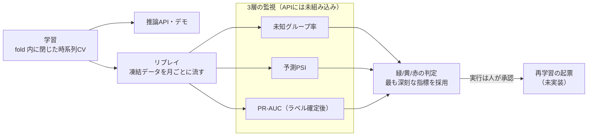
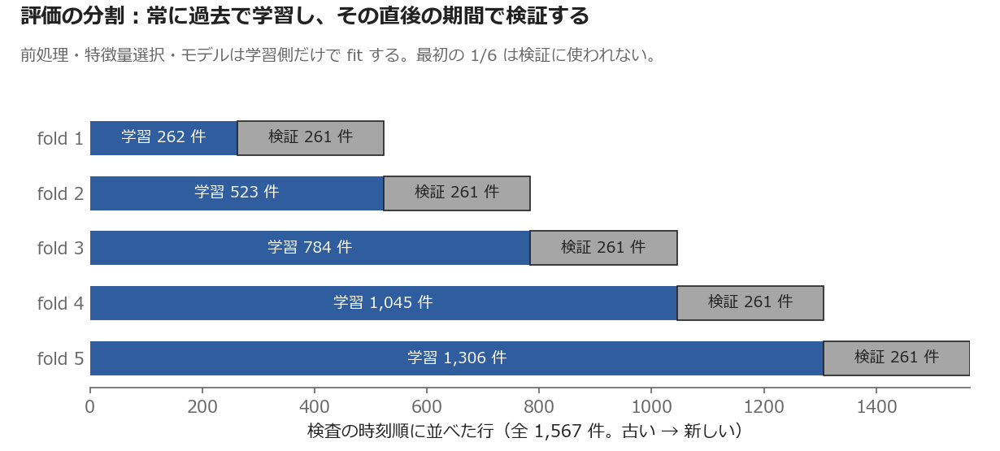
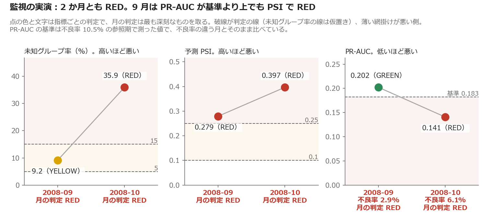

# SECOM 不良予測 ― リークを除くとAUCは0.61。その実力で使える範囲を決め、API化と監視の実演まで行った

半導体製造ラインのセンサーデータ（[UCI SECOM](https://archive.ics.uci.edu/dataset/179/secom)）で、精度に限界のあるモデルを誰でも同じ結果で再現でき、使える範囲が分かる状態にするには何が要るかを問う。全工程を fold 内に閉じた評価、検定によるしきい値・モデルの見直し、推論API（FastAPI + Docker）、ドリフト監視の実演までを行った。

[デモ（Hugging Face Spaces）](https://huggingface.co/spaces/yuya-h/secom-defect-demo) ／ 記事: [考察編](https://zenn.dev/yuya0408/articles/secom-defect-analysis)・[実装編](https://zenn.dev/yuya0408/articles/secom-defect-serving)・[運用編](https://zenn.dev/yuya0408/articles/secom-defect-operations)

> 示すのは、凍結データ上の評価、動く推論API、監視の計算と判定の実演である。実ラインでの効果、常時稼働の監視、再学習の実行は示さない（[限界と範囲外](#限界と範囲外)）。



---

## 結果サマリー

| 項目 | 値 |
|---|---|
| データ | 1,567 件 × 590 センサー、不良 104 件（**6.64%**）、欠損 4.54% |
| 評価（時系列CV、out-of-fold 1,305 件、不良 65 件） | **AUC 0.6074**（95% 区間 0.530〜0.684、0.5 に対して p = 0.006）、PR-AUC 0.1346（評価対象の不良率 0.050 の約 2.7 倍） |
| リークの影響（同じ構成、上位 100 列、時系列特徴量を含む） | AUC 0.7142 → 0.6108 |
| 既定しきい値 | **0.0612**（規則「不良確率の上位 50% を検査に回す」から計算。0.5 では 1 件も判定されない） |
| 上位 50% を検査したときの再現率 | **66.2%**（各 fold の中で順位を付けた場合。fold 別 60〜71%、ランダムなら 50%）。固定の 0.0612 をそのまま当てると、検査に回る割合は fold により 50〜98% に振れる |
| モデル 2 種・構成 5 種との比較 | **どれも現行と見分けられない**（Holm 補正後 p ≥ 0.136）。現行のまま |
| 品種情報を入れる 5 手法との比較 | 上積みは見分けられない。1 手法は現行より悪い |
| 監視のリプレイ（2008-09、2008-10） | 未知グループ率 9.2% → 35.9%。**2 か月とも RED** |

## 用語

| 用語 | 意味 |
|---|---|
| 時系列CV | 検査の時刻順に並べ、過去で学習して直後の期間で検証する 5 分割。前処理・特徴量選択・モデルはすべて学習側だけで fit する |
| out-of-fold | 学習に使っていない fold での予測。最初の 1/6 は学習専用で予測を持たない |
| 品種グループ | 欠損率 10〜70% の列の欠損パターンが同じサンプルの集まり。品種の代理と見る仮説で、確かめてはいない |
| 未知グループ率 | 参照期に無かった品種グループのサンプルの割合 |
| PSI | 予測確率の分布が基準からどれだけずれたかの指標（Population Stability Index） |
| r | 流出 1 件の損失 ÷ 検査 1 件の費用。業務上の仮定 |

---

## リークを除くとAUCは0.72→0.61に下がる

**全データで前処理と特徴量選択をしてから評価すると、同じ構成でも AUC は 0.1 以上高く見える。**

| 特徴量選択 | リークあり（全データで前処理・選択） | リークなし（fold 内で前処理・選択） | 差 |
|---|---|---|---|
| 上位 50 列 | 0.7023 | 0.5739 | +0.1283 |
| 上位 100 列 | 0.7142 | 0.6108 | +0.1035 |

当初の分析で出た 0.7180 のコードは残っていないので、同じ手順を作り直して確かめた。この表の構成は時系列特徴量（直前の品の不良数など）を含み、現行のモデル（AUC 0.6074）は含まない。根拠: [`reports/leak_check.md`](reports/leak_check.md)。



青で学習し、灰で検証する。行を下るほど学習データが増える。

## しきい値は確率の値ではなく順位で決める必要がある

**未知のデータの不良確率は最大 0.36 で、0.5 では 1 件も判定されない。確率は後の fold ほど低く出るので、値で決めたしきい値は再学習のたびにずれる。**

| 検査に回す割合 | 再現率 | ランダムの場合 |
|---|---|---|
| 30% | 38.5% | 30% |
| **50%（既定）** | **66.2%** | 50% |
| 70% | 84.6% | 70% |
| 90% | 92.3% | 90% |

既定しきい値 0.0612 は、最後の fold で上位 50% の境目にあたる値で、`src/train.py` が学習のたびに計算して `models/metadata.pkl` に記録する（API の `/metadata` で読める。評価値と一緒に保存するので、モデルとの組み合わせがずれない）。50% は、流出 1 件の損失が検査 1 件の費用の 20 倍（r = 20）という仮定で、10% 刻みの候補のうち費用が最も小さい割合である。**r が約 41 以上の工程では全数検査が最も安く、このモデルは使う理由がない。** 全割合の値・fold 別の値・費用の表は[詳しい結果](docs/results.md#検査割合ごとの再現率)にある。

## 未知グループ率は9%→36%に増え、監視は2か月ともREDを出す

**時系列で新しいグループが出ることは監視の指標でも見える。ただし 9 月は PR-AUC が基準より上でも PSI で RED になり、誤報かどうかはこのデータでは判断できない。**



点の色と文字が指標ごとの判定で、目盛りの色と文字が月の判定（最も深刻なものを取る）。

| 月 | 未知グループ率 | 予測 PSI | PR-AUC | 判定 |
|---|---|---|---|---|
| 2008-09 | 9.2%（黄） | 0.279（赤） | 0.202（基準以上） | RED |
| 2008-10 | **35.9%**（赤） | 0.397（赤） | 0.141（基準未満で赤） | RED |

赤の月は、推論は返すが該当ロットを全数検査へ回し、再学習を起票する（自動では実行しない）と定義した。定義は文字列だけで、実行するコードは無い。根拠: [`reports/drift_report.md`](reports/drift_report.md)・[`src/monitoring.py`](src/monitoring.py)。

## そのほかの検証：モデル・構成・品種情報は、どれも入れ替えるほどの差が無かった

- **モデルと構成**: ロジスティック回帰・HistGradientBoosting と、前処理・特徴量の構成 5 種を比べ、どれも現行と見分けられなかった（Holm 補正後 p ≥ 0.136）。区間の幅は ±0.07〜0.1 で、「同等」ではない。
- **欠損パターン（品種）**: 44 列の欠損パターンは 49 種類に収束し、不良率は 0〜23% に分かれるが、区間が広く、品種の違いとまでは言えない。
- **品種情報を入れる 5 手法**: どれも上積みを見分けられず、1 手法（グループ別 30）は現行より悪い。

表・図・根拠のレポートは[詳しい結果](docs/results.md#モデルと構成の比較)にある。

---

## 方法

| 項目 | 値 |
|---|---|
| 評価 | `TimeSeriesSplit` 5 分割（検査の時刻順）、fold 平均の AUC・PR-AUC |
| モデル（現行） | `RandomForestClassifier(n_estimators=200, max_depth=10, class_weight="balanced", random_state=42)`。比較で選んだのではなく、チューニングをほとんどせずに崩れにくい出発点として置いた。ハイパーパラメータは固定 |
| 前処理（現行） | 定数列・準定数列（95%）・高欠損列（50%）を削除、欠損率 5〜50% の列に欠損フラグ、中央値補完。590 → 460 列（436 列 + フラグ 24 列） |
| 比較の判定 | fold 別 DeLong に Holm 補正。p < 0.05 で相手が良いときだけ替え、それ以外は「見分けられない」 |
| 監視のリプレイ | 2008-07〜08（618 件、不良 65 件）を参照期として学習し、09・10 月を順に流す |

モデル・構成・品種情報の比較と、既定しきい値の 50% は、平均 AUC や再現率の表を見た後に決めた（2026-10。記事の公開は 2026-07 で、記事は当時の記録として書き換えていない）。規則の一覧は[詳しい結果](docs/results.md#判定の規則の一覧)にある。

| 監視の指標 | ラベル | 黄 | 赤 | 線の由来 |
|---|---|---|---|---|
| 未知グループ率 | 不要 | 5% | 15% | **仮置き**。実運用では誤報と見逃しの実績から決め直す前提 |
| 予測 PSI | 不要 | 0.10 | 0.25 | PSI で慣用される目安 |
| PR-AUC | 必要 | — | 基準 0.1825 未満 | 参照期の不良で層別した 5 分割の out-of-fold |

## 限界と範囲外

| 項目 | 何が言えないか |
|---|---|
| 小さな差 | 不良が 65 件で、±0.07〜0.1 未満の AUC の差は見分けられない。言えるのは「入れ替える理由が無い」までで、「同等」ではない |
| 凍結データ | 再学習もラインへの適用もしていない。示せるのは評価と仕組みまで |
| しきい値 0.0612 | fold によって検査に回る割合が 50〜98% と変わる。運用するなら直近の予測の分位点で置き直す前提 |
| 監視 | 2 か月分を別スクリプトで回した実演で、API とはつながっていない。誤報率・見逃し率は測れず、10 月の基準割れは不良率の違いで説明できる可能性がある |

ほかの留保（時系列特徴量のラベル、区間の狭さ、PSI の基準など）は[詳しい結果](docs/results.md#細かい留保)にある。

## 詳しい値

検査割合ごとの再現率、費用の表、fold ごとの値、比較の表、品種の図は [`docs/results.md`](docs/results.md) にある。

## 実行環境

| 用途 | 環境 |
|---|---|
| 手元の学習・図・同梱モデル | Windows 11、Python 3.13.7、CPU のみ（GPU 不要） |
| CI・Docker | Python 3.12。CI は `data/` から学習し直してテストする。Docker（`python:3.12-slim`）は同梱モデルで起動と推論を確かめた |
| デモ | Hugging Face Spaces、Python 3.13、Gradio 6.19.0。無料枠でスリープするので、開くと起動を待つことがある |
| 依存 | scikit-learn 1.8.0 ほか、`requirements*.txt` で固定 |

## 動かし方

```bash
# 1. 依存（テストまで）
pip install -r requirements-dev.txt

# 2. モデルを data/ から学習し直す（評価値・既定しきい値もここで計算される）
python -m src.train

# 3. API 起動 → http://localhost:8000/docs
uvicorn src.api:app --reload

# 4. 別の端末で推論を試す
curl -X POST http://localhost:8000/predict \
  -H "Content-Type: application/json" \
  -d @sample_input.json
# => {"defect_probability":0.6597...,"is_defect":true,"threshold":0.0612,"model_version":"1.1.0"}

# 5. テスト
pytest -q
```

`sample_input.json` は実データの不良の行で、**学習データに含まれる**。そのため確率は 0.66 と高く出る。Docker・比較と図の再生成・エンドポイントの一覧は [`docs/reproduce.md`](docs/reproduce.md) にある。

## ディレクトリ構成

| 場所 | 中身 |
|---|---|
| `src/` | 前処理（`preprocessing.py`）、学習としきい値の決定（`train.py`）、監視の判定（`monitoring.py`）、推論API（`api.py`） |
| `models/` | 学習済みの preprocessor / model / metadata |
| `scripts/` | 比較・リークの確認・リプレイ・図の作成（`make_figures.py`） |
| `reports/` | 比較とリプレイの結果、図（fig1〜fig7） |
| `notebooks/` | 考察編の分析 |
| `docs/` | [詳しい結果](docs/results.md)、[再現の詳細](docs/reproduce.md) |
| `app.py` | Gradio のデモ（Hugging Face Spaces へは手で同期） |
| `data/`・`tests/` | UCI のオリジナルファイル、API・監視のテスト |

ファイルごとの一覧は [`docs/reproduce.md`](docs/reproduce.md#ファイルの一覧) にある。

## データ・ライセンス・出典

- データ: McCann, M. & Johnston, A. (2008). *SECOM* [Dataset]. UCI Machine Learning Repository. <https://archive.ics.uci.edu/dataset/179/secom>（`data/` にオリジナルファイルをそのまま収録）
- コード・モデル: [MIT License](LICENSE)
- モデルの用途と限界: [`MODEL_CARD.md`](MODEL_CARD.md)
- DeLong 検定: DeLong, E. R., DeLong, D. M. & Clarke-Pearson, D. L. (1988). *Biometrics*, 44(3), 837–845.
