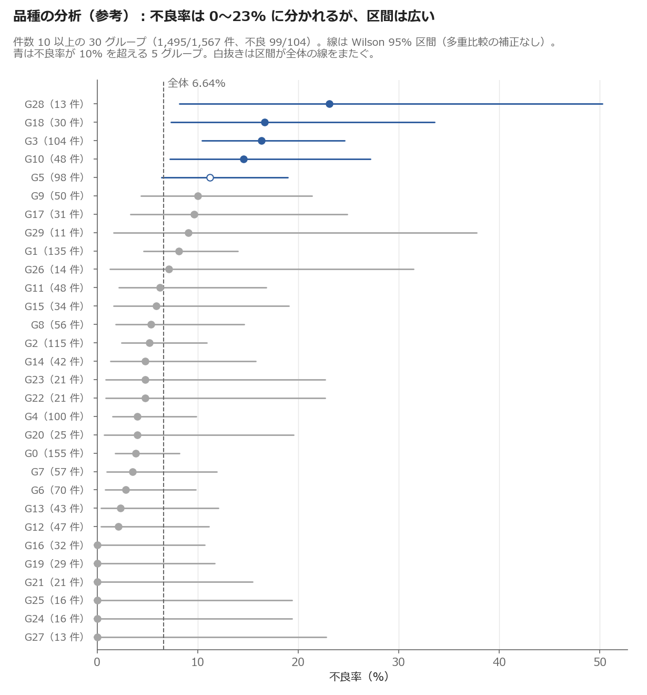
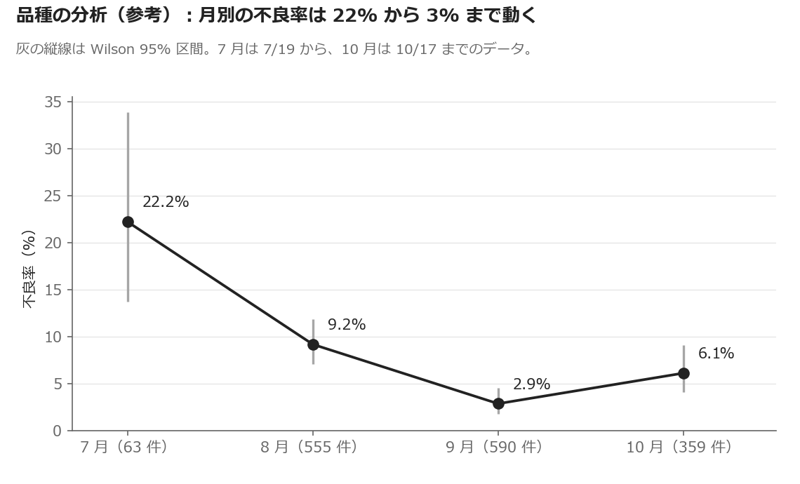
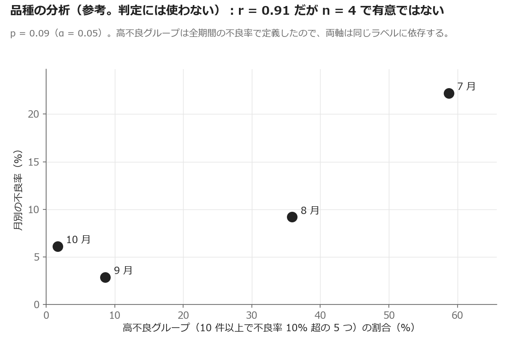
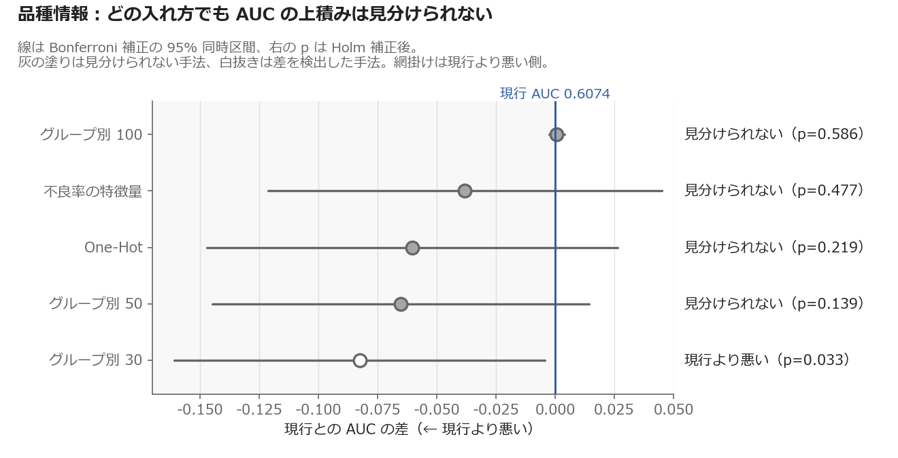
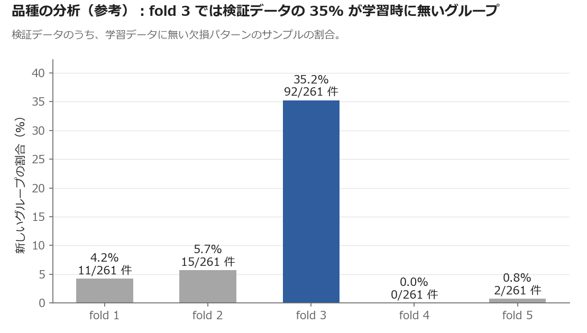

# 詳しい結果

READMEの結論の節に載せない値・比較・留保をまとめる。結論と読み方は [README](../README.md) にある。

## 検査割合ごとの再現率

`/metadata` の `threshold_rule.inspection_table` と同じ値。各 fold の中で順位を付けて上位を選んだ値で、固定の 0.0612 で出る値ではない。

| 検査に回す割合 | 再現率 | 適合率 | ランダムとの差 | fold 別の再現率（%） |
|---|---|---|---|---|
| 10% | 23.1% | 11.1% | +13.1 | 27 / 0 / 40 / 8 / 29 |
| 20% | 32.3% | 7.9% | +12.3 | 32 / 0 / 60 / 8 / 50 |
| 30% | 38.5% | 6.3% | +8.5 | 36 / 17 / 60 / 23 / 50 |
| 40% | 53.8% | 6.7% | +13.8 | 55 / 67 / 60 / 31 / 64 |
| 50% | 66.2% | 6.6% | +16.2 | 64 / 67 / 60 / 69 / 71 |
| 60% | 73.8% | 6.1% | +13.8 | 64 / 83 / 60 / 92 / 79 |
| 70% | 84.6% | 6.0% | +14.6 | 82 / 83 / 80 / 92 / 86 |
| 80% | 87.7% | 5.5% | +7.7 | 86 / 100 / 80 / 92 / 86 |
| 90% | 92.3% | 5.1% | +2.3 | 91 / 100 / 90 / 92 / 93 |

同じ 0.0612 を各 fold にそのまま当てると、検査に回る割合は fold 1 から順に 98% / 96% / 67% / 56% / 50%（全体 74%）、再現率は全体で 85% になる。根拠: [`reports/headline_checks.md`](../reports/headline_checks.md)。

## 費用と検査割合

```text
1 個あたりの費用 = 検査割合 + r × 不良率 × 見逃し率     （全数検査の費用は 1）
```

| r | 費用が最小の割合（1% 刻み） | 上位 50% の費用 | 全数検査との比較 |
|---|---|---|---|
| 15 | 7%（0.668） | 0.753 | 上位 50% の方が安い |
| **20** | 41%（0.824） | **0.837**（10% 刻みの候補では最小） | 上位 50% の方が安い |
| 25 | 69%（0.882） | 0.921 | 上位 50% の方が安い |
| 30 | 69%（0.920） | 1.006 | 上位 50% は全数検査より高い |
| 41 以上 | 100% | 1.0 超 | どの割合より全数検査が安い |

最適な割合は r で大きく動くので、50% は r = 20 の仮定に結びついた選択である。根拠: [`src/train.py`](../src/train.py) の `cost_breakeven`。

## fold ごとの値

| fold | 検証の件数 | 不良 | AUC | 確率の平均 | 確率の最大 | 新しいグループの割合 |
|---|---|---|---|---|---|---|
| 1 | 261 | 22 | 0.588 | 0.153 | 0.362 | 4.2% |
| 2 | 261 | 6 | 0.565 | 0.119 | 0.209 | 5.7% |
| 3 | 261 | 10 | 0.653 | 0.076 | 0.192 | 35.2% |
| 4 | 261 | 13 | 0.564 | 0.066 | 0.162 | 0.0% |
| 5 | 261 | 14 | 0.667 | 0.065 | 0.198 | 0.8% |

## モデルと構成の比較

入れ替える規則（Holm 補正後 p < 0.05 で相手が良いときだけ）を満たす相手は無く、現行のままにした。

| 比較の相手 | AUC | 現行との差 | 95% 区間（補正前） | p（Holm） | 判定 |
|---|---|---|---|---|---|
| ロジスティック回帰 | 0.6141 | +0.007 | [−0.098, +0.112] | 0.900 | 見分けられない |
| HistGradientBoosting | 0.5717 | −0.036 | [−0.108, +0.036] | 0.663 | 見分けられない |
| A: 雑な前処理 | 0.5210 | −0.086 | [−0.163, −0.010] | 0.136 | 見分けられない |
| B: 雑な前処理 + 時系列特徴量 | 0.5757 | −0.032 | [−0.096, +0.033] | 1.000 | 見分けられない |
| D: 現行 + 時系列特徴量 | 0.5985 | −0.009 | [−0.075, +0.057] | 1.000 | 見分けられない |
| E-50: D + 特徴量選択 50 列 | 0.5739 | −0.034 | [−0.104, +0.037] | 1.000 | 見分けられない |
| E-100: D + 特徴量選択 100 列 | 0.6108 | +0.003 | [−0.064, +0.071] | 1.000 | 見分けられない |

A の区間は 0 を含まないが、これは補正前の値で、補正後は規則を満たさない。根拠: [`reports/model_comparison.md`](../reports/model_comparison.md)・[`reports/config_comparison.md`](../reports/config_comparison.md)。

## 欠損パターン（品種）の分析

44 列の欠損パターンは 49 種類に収束し、グループの不良率は 0〜23% に分かれる。ただし区間は広く、月別の変動との関係も n = 4 で有意ではない。



点が不良率、線が Wilson 95% 区間。破線より右に区間全体がある青の 4 グループだけが、全体より高いと読める（白抜きの G5 はまたぐ）。



灰の縦線が Wilson 95% 区間。7 月は 63 件（7/19 から）しかなく、区間が広い。



1 点が 1 か月。高不良グループは全期間の不良率で定義したので、両軸は同じラベルに依存する。根拠: [`notebooks/secom_strict_analysis.ipynb`](../notebooks/secom_strict_analysis.ipynb) の Step 6。

| 月 | 件数 | 不良率 | 高不良グループの割合 | リプレイの AUC |
|---|---|---|---|---|
| 2008-07 | 63 | 22.2% | 58.7% | 参照期 |
| 2008-08 | 555 | 9.2% | 35.9% | 参照期 |
| 2008-09 | 590 | 2.9% | 8.6% | 0.705 |
| 2008-10 | 359 | 6.1% | 1.7% | 0.658 |

## 品種情報を入れる方法の比較

5 手法のどれも現行を上回ると言えず、グループ別 30 は Holm 補正後も現行より悪い。



0 の線より左（網掛け）が現行より悪い側。線は Bonferroni の同時区間で、0 をまたぐ手法は見分けられない。

| 手法 | AUC | 現行との差 | 95% 区間（補正前） | p（Holm） | 判定 |
|---|---|---|---|---|---|
| One-Hot | 0.5470 | −0.060 | [−0.126, +0.006] | 0.219 | 見分けられない |
| 不良率の特徴量 | 0.5693 | −0.038 | [−0.102, +0.025] | 0.477 | 見分けられない |
| グループ別 100 | 0.6081 | +0.001 | [−0.002, +0.003] | 0.586 | 見分けられない |
| グループ別 50 | 0.5422 | −0.065 | [−0.126, −0.005] | 0.139 | 見分けられない |
| グループ別 30 | 0.5249 | −0.083 | [−0.142, −0.023] | 0.033 | 現行より悪い |

学習時に無いグループの多さは、理由とは言えない。新しいグループが最も多い fold 3（35.2%）ではグループ別 50 が 0.725 と現行の 0.653 を上回り、大きく落ちるのは 0.8% しかない fold 5（0.364、現行 0.667）である。理由の候補はグループあたりのサンプルの少なさと、欠損フラグにグループの情報がすでに入っていることだが、切り分けていない。根拠: [`reports/group_info_comparison.md`](../reports/group_info_comparison.md)。



青が最も割合の高い fold。学習時に無いグループには、グループの情報を使えない。

## 評価値としきい値をモデルと一緒に保存する仕組み

手で書いた評価値を持たず、`src/train.py` が学習のたびに計算して `models/metadata.pkl` に保存する。同じ環境で学習し直すと、`model.pkl` はハッシュまで一致した。

| 仕組み | 何を防ぐか | 場所 |
|---|---|---|
| 前処理クラスを独立モジュールに置く | ノートブックで定義すると pickle のパスが `__main__` になり、別プロセスの API から復元できない | [`src/preprocessing.py`](../src/preprocessing.py) |
| 評価値・しきい値を学習時に計算して保存 | モデルと評価値・しきい値の組み合わせのずれ | [`src/train.py`](../src/train.py) |
| 応答にモデルの版を入れる | どの予測がどのモデルから出たか分からなくなること | [`src/api.py`](../src/api.py) |
| CI で `data/` から再学習してテスト | 同梱モデルに頼った動作確認 | [`.github/workflows/ci.yml`](../.github/workflows/ci.yml) |
| デモは API と同じコードとモデルを使う | デモと API の結果のずれ（同期は手動） | [`app.py`](../app.py) |

## 判定の規則の一覧

| 比較 | 検定 | 規則 | なぜその規則か |
|---|---|---|---|
| モデル 2 種 | fold 別 DeLong、2 比較に Holm | p < 0.05 で相手が良いときだけ替える | 替えると API・監視の基準・文書をやり直す費用がかかる |
| 構成 5 種 | fold 別 DeLong、5 比較に Holm | p < 0.05 でなければ「見分けられない」 | 平均 AUC の並びだけで最良と言わない |
| 品種情報 5 手法 | fold 別 DeLong、5 比較に Holm | 同上 | 同上 |
| 既定しきい値 | 検定なし | 上位 50% | r = 20 の仮定で 10% 刻みの最小 |

## 細かい留保

READMEの[限界と範囲外](../README.md#限界と範囲外)には結論の読み方を変える項目だけを置き、ここに全部を残す。

| 項目 | 何が言えないか | 結論への影響 | 根拠 |
|---|---|---|---|
| 不良が 65 件 | ±0.07〜0.1 未満の AUC の差を見分けられない | 比較の結論は「入れ替える理由が無い」までで、「同等」「現行が最良」ではない | [比較の表](#モデルと構成の比較) |
| 凍結データ | 再学習もラインへの適用もしていないので、実際の効果は分からない | 示せるのは評価と仕組みまで | — |
| 0.0612 の適用範囲 | 同じ値を fold 1 に当てると 98% が検査対象になる（fold 5 は 50%）。全データで学習した最終モデルの未知データでの割合は未検証 | 「上位 50%」が保たれるとは限らない。運用するなら直近の予測の分位点で置き直す前提 | `src/train.py` |
| 費用の仮定 | r は業務上の仮定で、再現率の曲線は不良 65 件の階段状 | 最適な割合は幅を持って読む | [費用の表](#費用と検査割合) |
| 0.7180 の出どころ | 当初のコードが無く、作り直しの値（0.7142）と一致はしない | リークの方向と大きさの確認にとどまる | [`reports/leak_check.md`](../reports/leak_check.md) |
| 監視の期間 | 2 か月だけで、誤報率も見逃し率も測れない | 判定の線の良し悪しは評価していない | [`reports/drift_report.md`](../reports/drift_report.md) |
| PSI の基準 | 基準は参照期の 8 割で学習した予測で、リプレイは全参照期で学習したモデルの予測。ずれの一部はこの差かもしれない（切り分けていない） | 9 月の RED は割り引いて読む | `scripts/replay_drift.py` |
| PR-AUC の基準（分割） | 時間順ではなく層別の分割で作った（時間順だと fold の不良が 18/21/13/6/7 件に偏る）。時間順より楽観的になりうる | 基準割れの判定は出やすい側 | `scripts/replay_drift.py` |
| PR-AUC の基準（不良率） | PR-AUC は不良率に左右されるのに、基準は不良率 10.5% の参照期の値で、月の不良率（2.9%、6.1%）と違う。不良率に対する倍率は基準 1.7 倍、9 月 7.0 倍、10 月 2.3 倍で、10 月の基準割れは不良率の違いで説明できる可能性がある | 性能の低下とは言えない。判定の規則は変えず、そのまま示している | [`src/monitoring.py`](../src/monitoring.py) |
| 監視と API | API は監視を呼ばない。`drift_warning` は未実装で、アラート・ダッシュボード・再学習パイプラインも無い | 監視は別スクリプトでの実演 | [`src/api.py`](../src/api.py) |
| 品種の解釈 | センサーが匿名で、欠損パターンが品種を表すかは確かめられない。推測である | 仮説の材料にとどめる | [品種の節](#欠損パターン品種の分析) |
| 時系列特徴量のラベル | 構成 B・D・E とリークの表の値は、直前の品の検査結果（不良かどうか）を特徴量に使う。全数検査で結果がすぐ分かる前提で、抜き取り検査では検査しなかった品のラベルが無い | 同梱のモデル（構成 C）には影響しない。B・D・E の値は全数検査の前提で読む | `scripts/compare_configs.py` |
| 区間と学習のばらつき | fold 別 DeLong は学習済みのモデルを固定したときのばらつきだけを数え、fold 間で入れ子に重なる学習データのばらつきは含まない | 区間は狭めに出る。「見分けられない」は保守的な側だが、品種情報の「グループ別 30 は現行より悪い」は割り引いて読む | `scripts/auc_tests.py` |
| PR-AUC の判定の幅 | 基準を少しでも下回ると RED で、許容幅が無い。月の不良は 17〜22 件で、PR-AUC の標本のばらつきは大きい | RED の一部は偶然でありうる。判定の規則は変えず、そのまま示している | [`src/monitoring.py`](../src/monitoring.py) |
| 時刻の意味 | タイムスタンプは検査時刻で、製造順と同じとは限らない | 時系列CVの順序は検査の順 | `data/secom.names` |
| 図 3 の循環 | 高不良グループを全期間の不良率で定義している | r = 0.91 は高めに出うる | `scripts/make_figures.py` |
